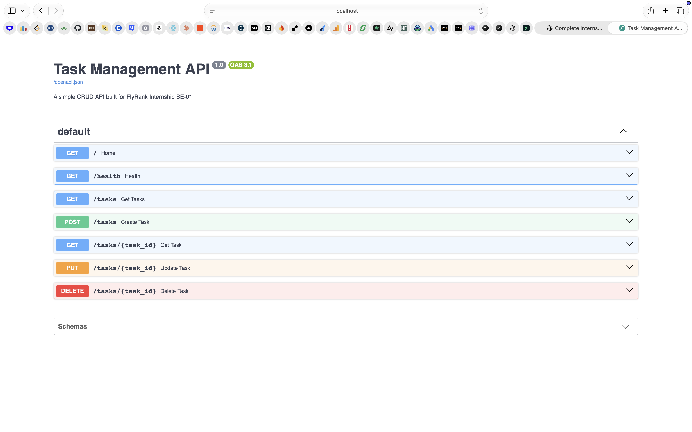

# Task Management CRUD API

## About
A simple REST API developed using Python and FastAPI
for the FlyRank Backend AI Engineering Internship.

## Technologies
- Python
- FastAPI
- Uvicorn
- Swagger UI

## Installation

Clone the repository:

git clone https://github.com/Aayush9-spec/flyrank-task-api.git

Navigate to the project:

cd flyrank-task-api

Create virtual environment:

python3 -m venv venv

Activate environment:

source venv/bin/activate

Install dependencies:

pip install -r requirements.txt

Run the application:

uvicorn main:app --reload

## API Documentation

Swagger UI:
http://localhost:8000/docs

## Endpoints

| Method | Endpoint | Description |
|---|---|---|
| GET | / | API information |
| GET | /health | Health check |
| GET | /tasks | Get all tasks |
| GET | /tasks/{task_id} | Get one task |
| POST | /tasks | Create task |
| PUT | /tasks/{task_id} | Update task |
| DELETE | /tasks/{task_id} | Delete task |

## Status Codes

- 200: Successful request
- 201: Task created
- 204: Task deleted
- 400: Invalid input
- 404: Task not found

## Database Storage

This project uses **PostgreSQL 16** to persist task data.

- Database: `flyrank_tasks`
- Database user: `flyrank`
- Database table: `tasks`
- Database driver: `psycopg`
- Schema: `sql/init.sql`
- Connection configuration: `DATABASE_URL`

PostgreSQL runs in Docker using Docker Compose. Docker volumes preserve database files across container restarts.

### Database Verification

Connect to PostgreSQL:

`docker compose exec db psql -U flyrank -d flyrank_tasks`

Example queries:

`SELECT * FROM tasks;`

`SELECT COUNT(*) FROM tasks;`

### Persistence Verification

A task was created through the FastAPI API and verified directly in PostgreSQL. Both Docker containers were restarted, and the task remained available afterward, confirming database persistence.

## Screenshots

### Swagger UI Documentation

