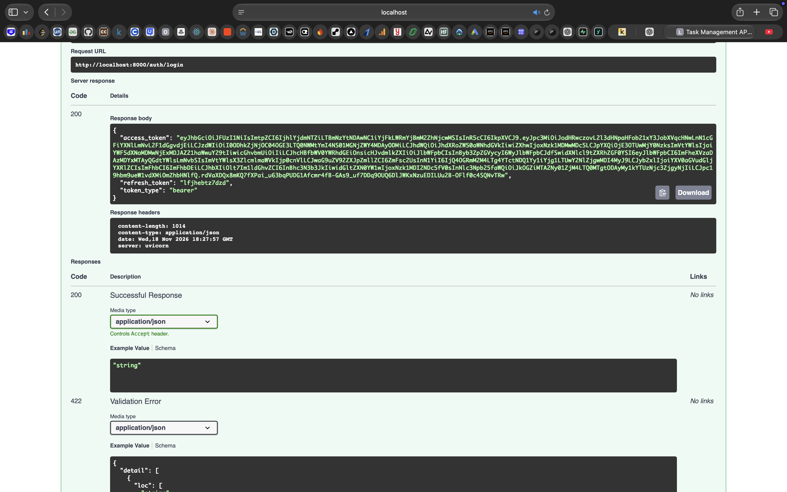

# Task Management API — FlyRank Internship

A RESTful Task Management API built with Python and FastAPI for the FlyRank Backend AI Engineering Internship. It includes PostgreSQL persistence, Supabase authentication, protected routes, and interactive Swagger documentation.

## Technologies

- Python
- FastAPI
- Uvicorn
- PostgreSQL 16
- Psycopg
- Supabase Auth
- Docker and Docker Compose
- Swagger UI

## Features

- Task CRUD operations
- PostgreSQL database persistence
- User signup and login with Supabase
- Supabase access-token verification
- Reusable authentication dependency
- Public and protected API routes
- Bearer-token authentication in Swagger UI
- Protected dashboard and profile endpoints
- Logout endpoint

## Setup

### 1. Clone the repository

```bash
git clone https://github.com/Aayush9-spec/flyrank-task-api.git
cd flyrank-task-api
```

### 2. Configure environment variables

Create `.env` only if it does not already exist:

```bash
if [ ! -f .env ]; then cp .env.example .env; fi
chmod 600 .env
```

Edit `.env` with your own PostgreSQL and Supabase credentials.

**Important:** Never commit or share your `.env` file.

### 3. Run with Docker Compose

```bash
docker compose up --build -d
docker compose ps
```

View application logs:

```bash
docker compose logs --tail 30 app
```

- API: http://localhost:8000
- Swagger UI: http://localhost:8000/docs

### 4. Run locally (optional)

```bash
python3 -m venv venv
source venv/bin/activate
pip install -r requirements.txt
uvicorn main:app --reload
```

Ensure PostgreSQL is running and environment variables are configured.

## API Endpoints

### General and task routes

| Method | Endpoint | Description |
|---|---|---|
| GET | `/` | API information |
| GET | `/health` | Health check |
| GET | `/tasks` | Get all tasks |
| GET | `/tasks/{task_id}` | Get a task |
| POST | `/tasks` | Create a task |
| PUT | `/tasks/{task_id}` | Update a task |
| DELETE | `/tasks/{task_id}` | Delete a task |

### Authentication routes

| Method | Endpoint | Access | Description |
|---|---|---|---|
| POST | `/auth/signup` | Public | Register a user |
| POST | `/auth/login` | Public | Authenticate a user |
| POST | `/auth/logout` | Protected | Log out an authenticated user |

### Profile and dashboard routes

| Method | Endpoint | Access | Description |
|---|---|---|---|
| GET | `/public/info` | Public | Public API information |
| GET | `/protected/profile` | Protected | Get authenticated user profile |
| GET | `/protected/dashboard` | Protected | Access protected dashboard |

Protected routes require a valid Supabase access token in the HTTP Bearer Authorization header.

## Authentication Testing

1. Open http://localhost:8000/docs.
2. Register or log in using the authentication endpoints.
3. Obtain the Supabase access token from the login response.
4. Select **Authorize** in Swagger UI and enter the access token.
5. Test the protected profile, dashboard, and logout endpoints.
6. Test a protected endpoint without a token to verify authentication.

## Database

- Database: `flyrank_tasks`
- Database user: `flyrank`
- Table: `tasks`
- Python driver: `psycopg`
- Schema: `sql/init.sql`
- Configuration: `DATABASE_URL`

PostgreSQL runs through Docker Compose with a named persistent volume.

Connect to PostgreSQL:

```bash
docker compose exec db psql -U flyrank -d flyrank_tasks
```

Example queries:

```sql
SELECT * FROM tasks;
SELECT COUNT(*) FROM tasks;
```

## HTTP Status Codes

- `200` — Successful request
- `201` — Resource created, where applicable
- `204` — Successful request with no response body
- `400` — Invalid request
- `401` — Missing or invalid authentication
- `404` — Resource not found

## Screenshots

### Swagger UI


### Authentication and Bearer Authorization



## Security

- Credentials are stored in the local `.env` file.
- `.env` is excluded from Git.
- `.env.example` contains placeholders only.
- Protected routes validate Supabase access tokens.
