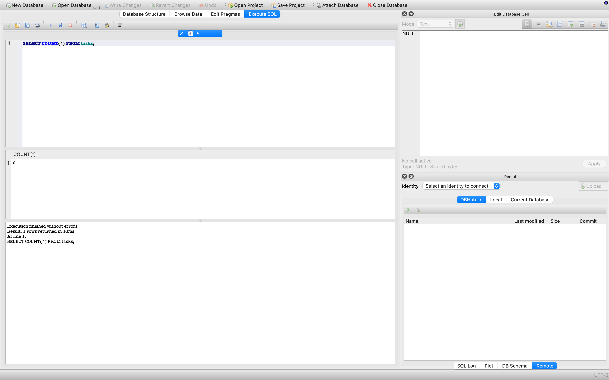
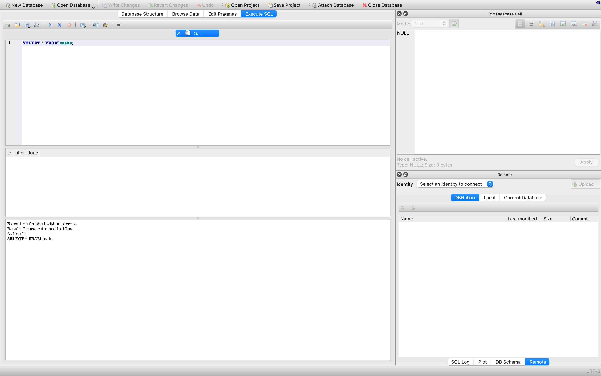

# Task Management CRUD API

## About
A simple REST API developed using Python and FastAPI
for the FlyRank Backend AI Engineering Internship.

## Technologies
- Python
- FastAPI
- Uvicorn
- Swagger UI

## Installation

Clone the repository:

git clone https://github.com/Aayush9-spec/flyrank-task-api.git

Navigate to the project:

cd flyrank-task-api

Create virtual environment:

python3 -m venv venv

Activate environment:

source venv/bin/activate

Install dependencies:

pip install -r requirements.txt

Run the application:

uvicorn main:app --reload

## API Documentation

Swagger UI:
http://localhost:8000/docs

## Endpoints

| Method | Endpoint | Description |
|---|---|---|
| GET | / | API information |
| GET | /health | Health check |
| GET | /tasks | Get all tasks |
| GET | /tasks/{task_id} | Get one task |
| POST | /tasks | Create task |
| PUT | /tasks/{task_id} | Update task |
| DELETE | /tasks/{task_id} | Delete task |

## Status Codes

- 200: Successful request
- 201: Task created
- 204: Task deleted
- 400: Invalid input
- 404: Task not found

## Database Storage

This project uses **SQLite** to persist task data.

- Database: `tasks.db`
- Database library: Python's built-in `sqlite3`
- Table: `tasks`
- The database and table are created automatically when the application starts.
- Three sample tasks are inserted only when the table is empty.
- Task data persists across server restarts.

The database file is created in the project directory and is excluded from Git using `.gitignore`.

## Database Verification

The database was inspected using DB Browser for SQLite.

The following SQL queries were executed:

```sql
SELECT * FROM tasks;
SELECT * FROM tasks WHERE done = 1;
SELECT COUNT(*) FROM tasks;
```

Manual database updates and deletions were also tested. The API reflects the changes made directly in SQLite.

### Database Screenshots

The following screenshots demonstrate the SQLite database inspection and SQL query execution using DB Browser for SQLite.





## Screenshots

### Swagger UI Documentation


